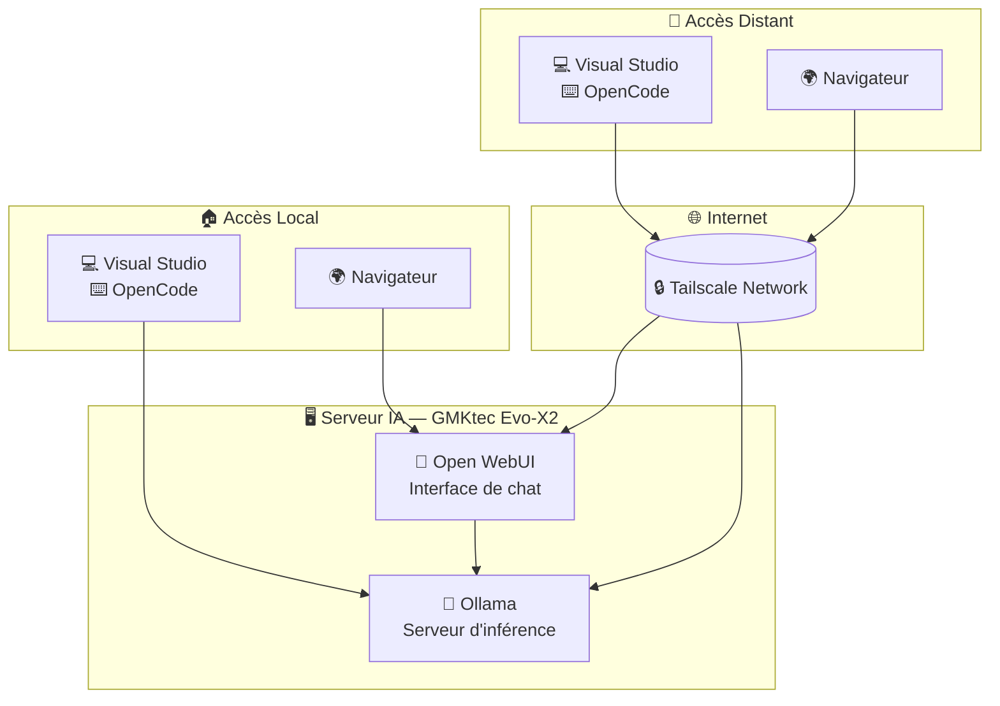

# IA locale

## Objectifs

- Accès à un chat web avec des fonctions "agentiques" de base
- Outils de développement agentique idéalement intégrés à Visual Studio 2026
- Accès depuis PC fixe/PC portable/tablette Android/téléphone Android
- Machine dédiée à l'inférence (pour éviter de devoir modifier le PC Fixe ou le laisser allumé en permanence)

## Architecture 

### Matériel

- [GMKtec Evo-X2 AI Mini-PC, AMD Ryzen AI Max+ 395, 96GB](https://www.amazon.fr/dp/B0FK2299GS) en tant que serveur. Consommation électrique (avec le coût de l'électricité en France):
	- 8 W au repos (15 à 20 €/ans)
  - 130 à 140 W lors de l'inférence (0,03 €/heure)
	
### Logiciel

- Ubuntu Server comme système d'exploitation
- Ollama comme serveur d'inférence
- Open WebUI comme interface de chat
- Modèles Unsloth : Alibaba [Qwen 3.6](https://unsloth.ai/docs/models/qwen3.6) et Google [Gemma 4](https://unsloth.ai/docs/models/gemma-4)
  - Modèle MOE : quantifié en 8 bits (Unsloth Dynamic, UD-Q8_K_XL)
  - Modèle dense : quantifié en 4 bits (Unsloth Dynamic, UD-Q4_K_XL)
  - Modèles MTP (Multi Token Prediction) avec 2 drafts pour un meilleur débit
- Réseau Tailscale pour usage hors domicile

## Mise en place

- [📘 Serveur AMD AI avec Ubuntu, Ollama et Open WebUI](ai/server.fr.md)
- [📘 Réseau Tailscale](ai/tailscale.fr.md)
- [📘 Visual Studio 2026](ai/vs2026.fr.md)
- [📘 OpenCode](ai/opencode.fr.md)

## Métriques

**Consommation mémoire et performance des modèles** :

| Modèle          | VRAM        | Performance (sortie)  |
|-----------------|------------:|----------------------:|
| Qwen3.6-35B-A3B | 39.8 Go     | Bonne:   64 token/sec |
| Gemma-4-26B-A4B | 27.9 Go[^1] | Bonne:   56 token/sec |
| Qwen3.8-27B     | 18.3 Go     | Faible:  20 token/sec |
| Gemma-4-31B     | 22.8 Go[^1] | Faible:  17 token/sec |

Note : le serveur a été configuré pour avoir 72 Go de VRAM (sur les 96 Go de mémoire unifiée) ; il devrait être possible de charger au moins deux modèles en même temps (pour limiter les temps de démarrage à froid). Cependant, il existe un [bug dans Ollama/ROCm](https://github.com/ollama/ollama/issues/16719) qui fait qu'un seul modèle peut être chargé à la fois.

Avec le meilleur modèle (Qwen3.6-35B-A3B), cela fait 0,13 € d'électricité par million de tokens générés.

[^1]: `ollama ps` affiche 1.1 Go ou 2.4 Go car seul le modèle DRAFT est pris en compte par la commande ollama. Cependant l'usage réel de la VRAM est celui indiqué dans le tableau (mesuré via ROCm).