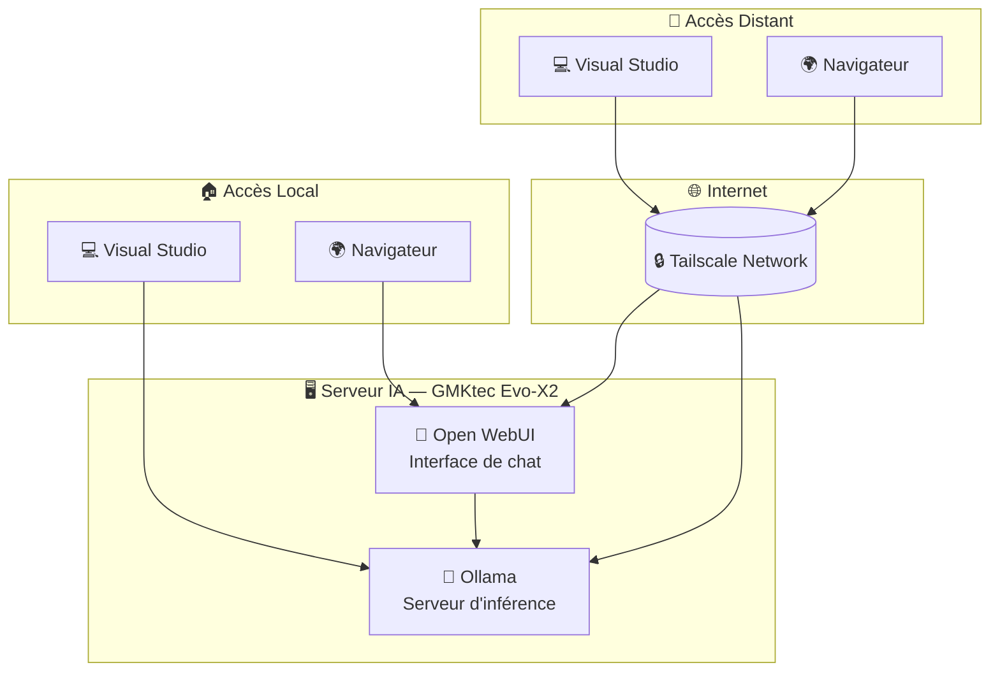

# IA locale

## Objectifs

- Accès à un chat web avec des fonctions "agentiques" de base
- Outils de développement agentique idéalement intégrés à Visual Studio 2026
- Accès depuis PC fixe/PC portable/tablette Android/téléphone Android
- Machine dédiée à l'inférence (pour éviter de devoir modifier le PC Fixe ou le laisser allumé en permanence)

## Architecture 

### Matériel

- [GMKtec Evo-X2 AI Mini-PC, AMD Ryzen AI Max+ 395, 96GB](https://www.amazon.fr/dp/B0FK2299GS) en tant que serveur. Consommation électrique :
	- 8 W au repos (15 à 20 €/ans)
  - 130 à 140 W lors de l'inférence (0,03 €/heure)
	
### Logiciel

- Ubuntu Server comme système d'exploitation
- Ollama comme serveur d'inférence
- Open WebUI comme interface de chat
- Modèles Unsloth : Alibaba [Qwen 3.6](https://unsloth.ai/docs/models/qwen3.6) et Google [Gemma 4](https://unsloth.ai/docs/models/gemma-4)
  - Modèles MOE: quantifiés en 8 bits (Unsloth Dynamic, UD-Q8_K_XL)
  - Modèles denses: quantifiés en 4 bits (Unsloth Dynamic, UD-Q4_K_XL)
  - Modèles Qwen 3.6: MTP (Multi Token Prediction) avec 2 draft pour un meilleur débit
- Réseau Tailscale pour usage hors domicile

## Mise en place

- [📘 Serveur AMD AI avec Ubuntu, Ollama et Open WebUI](ai/server.fr.md)
- [📘 Réseau Tailscale](ai/tailscale.fr.md)
- [📘 Visual Studio 2026](ai/vs2026.fr.md)

## Métriques

**Consommation mémoire et performance des modèles** :

| Modèle          | VRAM    | Performance (sortie)  |
|-----------------|--------:|----------------------:|
| Qwen3.6-35B-A3B | 39.8 Go | Bonne:   64 token/sec |
| Gemma-4-26B-A4B | 27.9 Go[^1] | Bonne:   56 token/sec |
| Qwen3.6-27B     | 19.1 Go | Faible:  12 token/sec |
| Gemma-4-31B     | 22.4 Go | Faible:   9 token/sec |

Note : le serveur a été configuré pour avoir 72 Go de VRAM (sur les 96 Go de mémoire unifiée) ; il devrait être possible de charger au moins deux modèles en même temps (pour limiter les temps de démarrage à froid). Cependant, il existe un [bug dans Ollama/ROCm](https://github.com/ollama/ollama/issues/16719) qui fait qu'un seul modèle peut être chargé à la fois.

Avec le meilleur modèle (Qwen3.6-35B-A3B), cela fait 0,13 € d'électricité par million de tokens générés.

[^1]: `ollama ps` affiche 1.1 Go, mais le modèle utilise bien 27.9 Go. Seul le modèle DRAFT est compatibilisé.