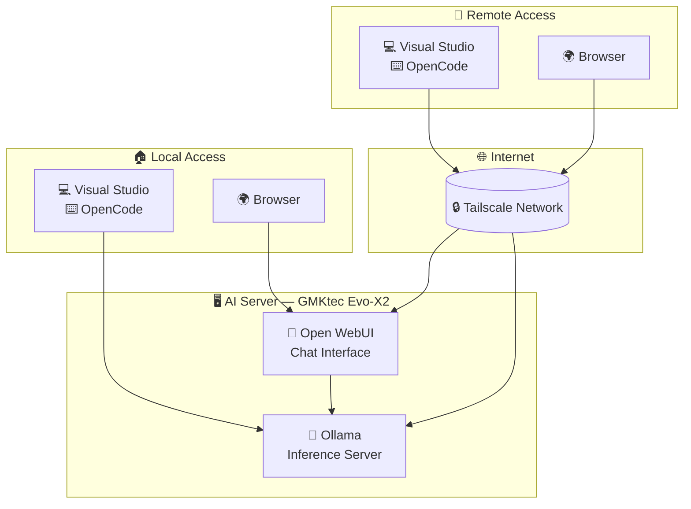

# Local AI

## Objectives

- Access to a web chat with basic "agent-like" functions
- Agent-like development tools ideally integrated into Visual Studio 2026
- Access from desktop PC/laptop/Android tablet/Android phone
- Dedicated inference machine (to avoid having to modify the Desktop PC or leave it on permanently)

## Architecture 

### Hardware

- [GMKtec Evo-X2 AI Mini-PC, AMD Ryzen AI Max+ 395, 96GB](https://www.amazon.fr/dp/B0FK2299GS) as the server. Power consumption (with cost of electricity in France):
	- 8 W at idle (15 to 20 €/year)
  - 130 to 140 W during inference (0.03 €/hour)
	
### Software

- Ubuntu Server as the operating system
- Ollama as the inference server
- Open WebUI as the chat interface
- Unsloth models: Alibaba [Qwen 3.6](https://unsloth.ai/docs/models/qwen3.6) and Google [Gemma 4](https://unsloth.ai/docs/models/gemma-4)
  - MOE models: quantized at 8 bits (Unsloth Dynamic, UD-Q8_K_XL)
  - Dense models: quantized at 4 bits (Unsloth Dynamic, UD-Q4_K_XL)
  - MTP models (Multi Token Prediction) with 2 drafts for better throughput
- Tailscale network for off-site usage

## Setup

- [📘 AMD AI Server with Ubuntu, Ollama and Open WebUI](ai/server.md)
- [📘 Tailscale Network](ai/tailscale.md)
- [📘 Visual Studio 2026](ai/vs2026.md)
- [📘 OpenCode](ai/opencode.fr.md)

## Metrics

**Memory consumption and model performance** :

| Model           | VRAM        | Performance (output)  |
|-----------------|------------:|----------------------:|
| Qwen3.6-35B-A3B | 39.8 GB     | Good:     64 token/sec |
| Gemma-4-26B-A4B | 27.9 GB[^1] | Good:     56 token/sec |
| Qwen3.8-27B     | 18.3 GB     | Low:      20 token/sec |
| Gemma-4-31B     | 22.8 GB[^1] | Low:      17 token/sec |

Note: the server was configured with 72 GB of VRAM (out of 96 GB of unified memory); it should be possible to load at least two models at the same time (to limit cold start times). However, there is a [bug in Ollama/ROCm](https://github.com/ollama/ollama/issues/16719) that allows only one model to be loaded at a time.

With the best model (Qwen3.6-35B-A3B), that amounts to 0.13 € of electricity per million tokens generated.

[^1]: `ollama ps` shows 1.1 GB or 2.4 GB because only the DRAFT model is accounted for by the ollama command. However, the actual VRAM usage is as indicated in the table (measured via ROCm).
